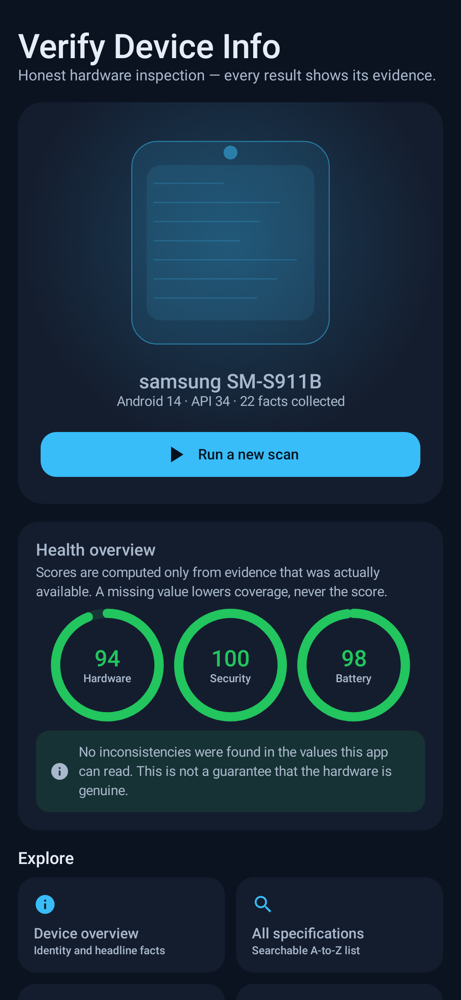
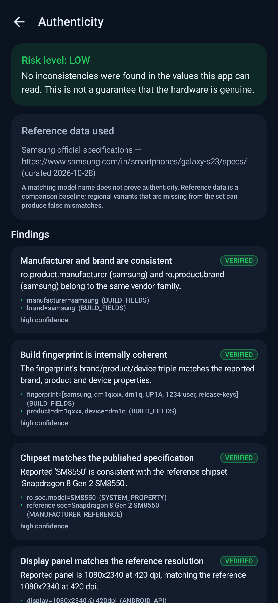
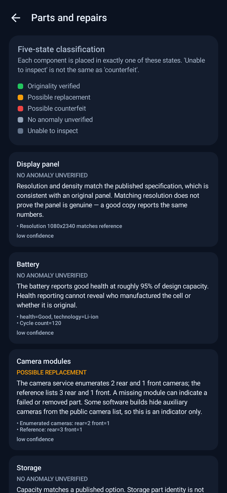
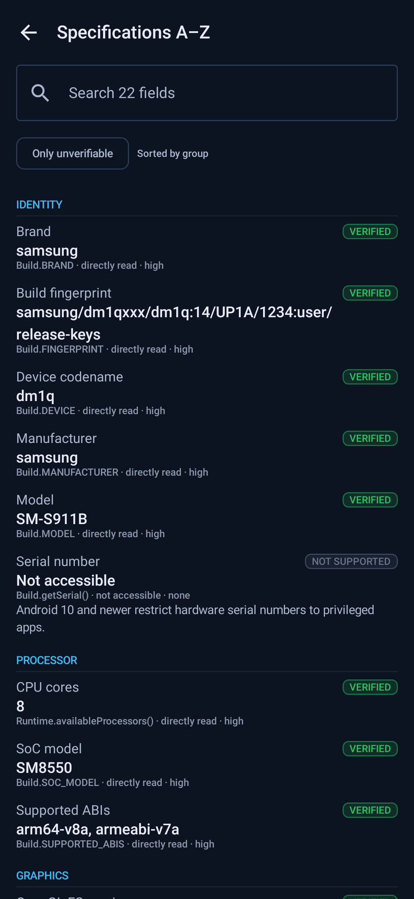
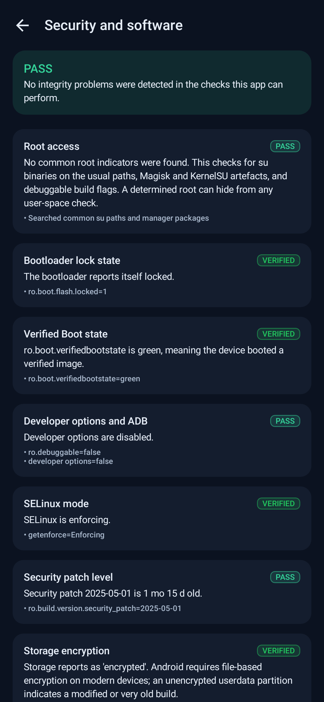
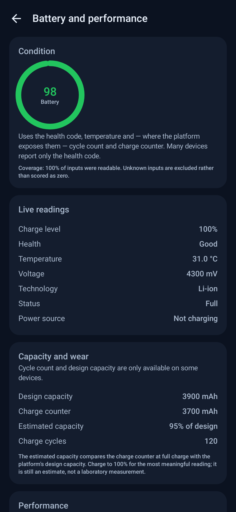
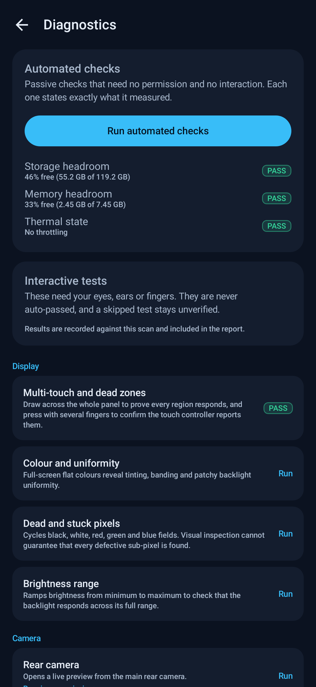

<div align="center">


<a href="https://github.com/technicalnihilist-lgtm/verify-device-info/stargazers"></a>&nbsp;<a href="https://github.com/technicalnihilist-lgtm/verify-device-info/network/members"></a>

<a href="https://github.com/technicalnihilist-lgtm/verify-device-info/releases/latest"></a>

<b>Support the work</b>

  

<sub>Donations aren't live yet — Paytm, UPI, PayPal and Buy&nbsp;Me&nbsp;a&nbsp;Coffee all show <b>coming soon</b>. Until then, a ⭐ star is the best support.</sub>

<a href="https://github.com/technicalnihilist-lgtm/verify-device-info/releases/latest"></a>  <a href="https://github.com/technicalnihilist-lgtm/verify-device-info/releases"></a>

</div>

---

## Screenshots

<p>



</p>
<p>



</p>
<p>

</p>

These are renderings of the shipping composables, produced on the JVM by Robolectric + Roborazzi
(`app/src/test/kotlin/com/verifydeviceinfo/ScreenshotTest.kt`) — not captures from a phone, because
this project was built without access to a device or emulator. The values shown come from the test
fixture, not from a real handset. Regeneration instructions are in
[docs/BUILDING.md](docs/BUILDING.md#regenerating-the-screenshots).

---

## What it does

### Complete device information
Every readable property is collected and shown with its **value, source, confidence level and
verification state** (`directly verified`, `inferred`, or `inaccessible`). That includes identity and
build properties, SoC, GPU, CPU, RAM, storage, display, battery, cameras, sensors, radios, audio
endpoints, biometrics and security configuration. The full list is searchable, A-to-Z.

### Original vs fake hardware analysis
An evidence-based engine compares the device against a bundled reference set of manufacturer
specifications: chipset, display resolution and density, memory and storage options, camera count and
resolution, expected sensors, build fingerprint coherence, signing keys, build type and timestamp,
and emulator markers. Each finding carries its evidence and a confidence level, and each is phrased as
an indicator rather than a verdict.

### Parts and repair analysis
A dedicated module classifies display, battery, cameras, storage, sensors, port/audio/haptics and
motherboard identity into exactly one of five states:

| State | Meaning |
|---|---|
| `ORIGINALITY_VERIFIED` | An official source confirmed the part. Android exposes no such source today, so this is normally empty. |
| `POSSIBLE_REPLACEMENT` | Supporting evidence was detected. |
| `POSSIBLE_COUNTERFEIT` | Multiple independent inconsistencies, or an incompatible component signature. |
| `NO_ANOMALY_UNVERIFIED` | Nothing inconsistent, but originality is unconfirmed. |
| `UNABLE_TO_INSPECT` | The platform would not disclose enough to judge. |

### Device age
Five independent values, never merged into one misleading number: model launch age, firmware build
age, ownership age (from a purchase date you supply), estimated usage age, and time since the last
security patch. The model's launch date is never presented as this handset's manufacturing date, and
no serial number is decoded.

### Deep hardware diagnostics
Interactive tests for multi-touch and dead zones, display colour/uniformity/dead pixels/brightness,
front and rear cameras, flashlight, speaker, earpiece, microphone (with measured levels), vibration,
accelerometer, gyroscope, proximity, ambient light, compass, GNSS, Wi-Fi, Bluetooth, NFC, charging and
battery temperature, thermal state, and biometric availability. Plus passive automated checks that
need no permission and state exactly what they measured.

### System integrity
Root indicators, bootloader lock state, Verified Boot state, SELinux mode, developer/ADB settings,
storage encryption, hardware-backed keystore (probed by generating and deleting a throw-away key),
StrongBox, security-patch age, and installer provenance. Nothing is bypassed, exploited or secretly
accessed.

### Health scores that explain themselves
Seven separate scores — hardware, software and security, component authenticity confidence, battery,
display and sensors, performance, and repair-evidence completeness. Each lists its inputs and weights,
and each reports **coverage**. Unknown data lowers coverage, never the score. Below 30% coverage the
score is withheld rather than guessed.

### Reports
PDF and JSON export, shareable through the system share sheet, with sensitive identifiers redacted by
default. Every export includes the test-by-test results, the evidence behind each finding, and an
explicit list of everything that could not be verified and why.

---

## The rules this app follows

1. **No invented data.** Serial numbers, cycle counts, repair dates and service records are either
   read from the platform or reported as inaccessible.
2. **No fake scans.** The progress bar advances only when a collection stage has actually finished.
   A test that was not run stays `UNVERIFIED`; it is never auto-passed.
3. **No proof claims.** A matching model name does not prove authenticity, and a passing integrity
   check does not prove genuine hardware.
4. **Missing ≠ faulty.** Unavailable data is `UNVERIFIED` or `NOT_SUPPORTED`, never a failure.
5. **Refurbished ≠ counterfeit.** Refurbishment is legitimate and is not treated as fraud.
6. **Every result carries a status**, from this closed set: `VERIFIED`, `PASS`, `WARNING`, `FAILED`,
   `UNVERIFIED`, `NOT_SUPPORTED`, `PERMISSION_REQUIRED`.
7. **Mock data never mixes with real scans.** The development fixture is reachable only in debug
   builds and every surface that shows it labels it as mock.

---

## Install

Download `VerifyDeviceInfo-1.0.0-release.apk` and install it (Android 8.0 / API 26 or newer).

```bash
adb install -r VerifyDeviceInfo-1.0.0-release.apk
```

The release APK is signed with a project key (v2 scheme). It is not published on Google Play.

## Build from source

Requirements: JDK 17, Android SDK with platform 35 and build-tools 35.x.

```bash
git clone <this repository>
cd VerifyDeviceInfo
./gradlew assembleDebug          # debug APK
./gradlew testDebugUnitTest      # unit tests
./gradlew assembleRelease        # signed release (needs keystore.properties, see docs/BUILDING.md)
```

See [docs/BUILDING.md](docs/BUILDING.md) for signing, CI and troubleshooting.

---

## Project structure

```
app/src/main/kotlin/com/verifydeviceinfo/
├── core/            Platform-free model: statuses, confidence, evidence, snapshot, reports
├── domain/          Interfaces + pure-Kotlin analysis engines (portable to iOS)
│   ├── analysis/    Authenticity, parts, age, integrity, scoring
│   └── report/      JSON encoder
├── data/android/    Android implementations: collectors, probes, PDF writer, history
├── ui/              Jetpack Compose UI: dashboard, reports, interactive tests
└── AppContainer.kt  Manual dependency graph
app/src/main/assets/device_reference.json    Curated manufacturer reference set
app/src/test/                                Unit tests for the analysis engines
docs/                                        Architecture, limitations, privacy, build guide
```

Full design notes: [docs/ARCHITECTURE.md](docs/ARCHITECTURE.md).
What the app cannot do, and why: [docs/LIMITATIONS.md](docs/LIMITATIONS.md).

---

## Privacy

The app makes **no network requests**. There is no analytics, no telemetry and no cloud dependency.
Scan history is stored in app-private storage and can be cleared at any time. Reports leave the device
only when you explicitly share them, with identifiers redacted by default.
See [docs/PRIVACY.md](docs/PRIVACY.md).

## Testing

28 unit tests cover the analysis engines: sub-brand recognition, part-number vs marketing-name chipset
matching, fingerprint parsing, risk aggregation, spoofed fingerprints, emulator detection, missing
reference data, the five-state parts classification, age-source separation, and score coverage
behaviour.

```bash
./gradlew testDebugUnitTest
```

## iOS

This repository contains the Android implementation only. The `core` and `domain` layers are written
in platform-free Kotlin, so an iOS app would implement the same interfaces in Swift and reuse the
report schema. **No iOS support is claimed or simulated here** — this build never displays Android
data as if it came from an iPhone.

## Licence

MIT. See [LICENSE](LICENSE).

---

---

## 🌍 Languages

<sub>Donations are <b>coming soon</b> in every language below — nothing to pay today, nothing to click.</sub>

<div align="center">

<sub><b>हिन्दी · বাংলা · मराठी · తెలుగు · தமிழ் · ગુજરાતી · ಕನ್ನಡ · മലയാളം · ਪੰਜਾਬੀ · ଓଡ଼ିଆ · অসমীয়া · اردو</b></sub>

</div>

<details>
<summary><b>🌍 Open the same message in 53 languages</b></summary>

**🇮🇳 Indian languages**

- **हिन्दी** (Hindi) — ☕ जल्द ही आ रहा है। · ⭐ अगर आपको यह ऐप और हमारा काम पसंद है, तो कृपया रिपॉजिटरी को स्टार दें और हमें फॉलो करें।
- **বাংলা** (Bengali) — ☕ খুব শিগগিরই আসছে। · ⭐ যদি আপনার এই অ্যাপ এবং আমাদের কাজ ভালো লাগে, তবে অনুগ্রহ করে রিপোজিটরিটিকে একটি স্টার দিন এবং আমাদের ফলো করুন।
- **मराठी** (Marathi) — ☕ लवकरच येत आहे. · ⭐ जर तुम्हाला हे ॲप आणि आमचं काम आवडलं असेल, तर कृपया रिपॉझिटरीला स्टार द्या आणि आम्हाला फॉलो करा.
- **తెలుగు** (Telugu) — ☕ త్వరలో రాబోతోంది. · ⭐ మీకు ఈ యాప్, మా పని నచ్చితే, దయచేసి రిపోజిటరీకి ఒక స్టార్ ఇచ్చి మమ్మల్ని ఫాలో అవ్వండి.
- **தமிழ்** (Tamil) — ☕ விரைவில் வருகிறது. · ⭐ உங்களுக்கு இந்த ஆப்பும் எங்க வேலையும் பிடிச்சிருந்தா, தயவுசெஞ்சு இந்த ரெபாசிட்டரிக்கு ஒரு ஸ்டார்…
- **ગુજરાતી** (Gujarati) — ☕ ટૂંક સમયમાં આવી રહ્યું છે. · ⭐ જો તમને આ એપ અને અમારું કામ ગમતું હોય, તો પ્લીઝ રિપોઝિટરીને સ્ટાર આપો અને અમને ફોલો કરો.
- **ಕನ್ನಡ** (Kannada) — ☕ ಶೀಘ್ರದಲ್ಲೇ ಬರುತ್ತಿದೆ. · ⭐ ನಿಮಗೆ ಈ ಆ್ಯಪ್ ಮತ್ತು ನಮ್ಮ ಕೆಲಸ ಇಷ್ಟವಾದರೆ, ದಯವಿಟ್ಟು ರೆಪೊಸಿಟರಿಗೆ ಸ್ಟಾರ್ ಕೊಡಿ ಮತ್ತು ನಮ್ಮನ್ನು ಫಾಲೋ ಮಾಡಿ.
- **മലയാളം** (Malayalam) — ☕ ഉടൻ വരുന്നു. · ⭐ നിങ്ങൾക്ക് ഈ ആപ്പും ഞങ്ങളുടെ പ്രവർത്തനവും ഇഷ്ടപ്പെട്ടെങ്കിൽ, ദയവായി റെപ്പോസിറ്ററിക്ക് ഒരു സ്റ്റാർ…
- **ਪੰਜਾਬੀ** (Punjabi) — ☕ ਜਲਦੀ ਆ ਰਿਹਾ ਹੈ। · ⭐ ਜੇ ਤੁਹਾਨੂੰ ਇਹ ਐਪ ਅਤੇ ਸਾਡਾ ਕੰਮ ਪਸੰਦ ਹੈ, ਤਾਂ ਕਿਰਪਾ ਕਰਕੇ ਰਿਪੋਜ਼ਟਰੀ ਨੂੰ ਸਟਾਰ ਦਿਓ ਅਤੇ ਸਾਨੂੰ ਫਾਲੋ ਕਰੋ।
- **ଓଡ଼ିଆ** (Odia) — ☕ ଖୁବ୍ ଶୀଘ୍ର ଆସୁଛି। · ⭐ ଯଦି ଆପଣଙ୍କୁ ଏହି ଆପ୍ ଏବଂ ଆମର କାମ ଭଲ ଲାଗୁଛି, ତେବେ ଦୟାକରି ରିପୋଜିଟୋରୀକୁ ଗୋଟିଏ ଷ୍ଟାର୍ ଦିଅନ୍ତୁ ଏବଂ ଆମକୁ ଫଲୋ କରନ୍ତୁ।
- **অসমীয়া** (Assamese) — ☕ অতি সোনকালেই আহি আছে। · ⭐ যদি আপুনি এই এপটো আৰু আমাৰ কাম ভাল পায়, তেন্তে অনুগ্ৰহ কৰি ৰিপজিটৰীটোক এটা ষ্টাৰ দিয়ক আৰু আমাক ফ'ল' কৰক।
- **اردو** (Urdu) — ☕ جلد آرہا ہے۔ · ⭐ اگر آپ کو یہ ایپ اور ہمارا کام پسند آئے تو براہ کرم ریپازٹری کو سٹار دیں اور ہمیں فالو کریں۔
- **संस्कृतम्** (Sanskrit) — ☕ शीघ्रमेव आगच्छति।
- **मैथिली** (Maithili) — ☕ जल्दिये आबि रहल अछि।
- **कोंकणी** (Konkani) — ☕ रोखडेंच येता.
- **کٲشُر** (Kashmiri) — ☕ جَلدی یِوان چھُ۔
- **سنڌي** (Sindhi) — ☕ जल्द अची रह्यो आहे।
- **डोगरी** (Dogri) — ☕ जल्दी आ करदा ऐ।
- **ꯃꯤꯇꯩ ꯂꯣꯟ** (Manipuri) — ☕ ꯑꯊꯨꯕꯥ ꯃꯇꯝꯗꯥ ꯂꯥꯛꯀꯅꯤ꯫
- **बर’** (Bodo) — ☕ थाबैनो फैगोन।
- **ᱥᱟᱱᱛᱟᱲᱤ** (Santali) — ☕ ᱞᱚᱜᱚᱱ ᱦᱤᱡᱩᱜ ᱠᱟᱱᱟ᱾
- **नेपाली** (Nepali) — ☕ छिट्टै आउँदैछ। · ⭐ यदि तपाईंलाई यो एप र हाम्रो काम मन पर्‍यो भने, कृपया रिपोजिटरीलाई स्टार दिनुहोस् र हामीलाई फलो गर्नुहोस्।

**🌍 World languages**

- **العربية** (Arabic) — ☕ قريبًا. · ⭐ إذا أعجبك هذا التطبيق وعملنا، فيرجى منح المستودع نجمة ومتابعتنا.
- **简体中文** (Chinese (Simplified)) — ☕ 即将推出。
- **繁體中文** (Chinese (Traditional)) — ☕ 即將推出。
- **Čeština** (Czech) — ☕ Již brzy.
- **Dansk** (Danish) — ☕ Kommer snart.
- **Nederlands** (Dutch) — ☕ Binnenkort beschikbaar. · ⭐ Vind je deze app en ons werk leuk?
- **Filipino** (Filipino) — ☕ Malapit na.
- **Suomi** (Finnish) — ☕ Tulossa pian.
- **Français** (French) — ☕ Bientôt disponible. · ⭐ Si cette application et notre travail vous plaisent, mettez une étoile au dépôt et suivez-nous.
- **Deutsch** (German) — ☕ Bald verfügbar. · ⭐ Wenn dir diese App und unsere Arbeit gefallen, gib dem Repository einen Stern und folge uns.
- **Ελληνικά** (Greek) — ☕ Έρχεται σύντομα.
- **עברית** (Hebrew) — ☕ בקרוב.
- **Magyar** (Hungarian) — ☕ Hamarosan.
- **Bahasa Indonesia** (Indonesian) — ☕ Segera hadir. · ⭐ Jika kamu suka aplikasi ini dan karya kami, beri bintang pada repositori ini dan ikuti kami.
- **Italiano** (Italian) — ☕ In arrivo.
- **日本語** (Japanese) — ☕ 近日公開。 · ⭐ このアプリと私たちの仕事が気に入ったら、リポジトリにスターを付けてフォローしてください。
- **한국어** (Korean) — ☕ 곧 공개됩니다. · ⭐ 이 앱과 저희 작업이 마음에 드신다면 저장소에 스타를 눌러 주시고 팔로우해 주세요.
- **Bahasa Melayu** (Malay) — ☕ Akan datang.
- **Norsk** (Norwegian) — ☕ Kommer snart.
- **فارسی** (Persian) — ☕ به‌زودی.
- **Polski** (Polish) — ☕ Wkrótce. · ⭐ Jeśli podoba Ci się ta aplikacja i nasza praca, daj repozytorium gwiazdkę i obserwuj nas.
- **Português** (Portuguese) — ☕ Em breve.
- **Română** (Romanian) — ☕ În curând.
- **Русский** (Russian) — ☕ Скоро. · ⭐ Если вам нравится это приложение и наша работа, поставьте звёздочку репозиторию и подпишитесь на нас.
- **Español** (Spanish) — ☕ Muy pronto. · ⭐ Si te gusta esta app y nuestro trabajo, dale una estrella al repositorio y síguenos.
- **Kiswahili** (Swahili) — ☕ Inakuja hivi karibuni.
- **Svenska** (Swedish) — ☕ Kommer snart.
- **ไทย** (Thai) — ☕ เร็ว ๆ นี้
- **Türkçe** (Turkish) — ☕ Çok yakında.
- **Українська** (Ukrainian) — ☕ Незабаром.
- **Tiếng Việt** (Vietnamese) — ☕ Sắp ra mắt. · ⭐ Nếu bạn thích ứng dụng này và công việc của chúng tôi, hãy tặng kho lưu trữ một ngôi sao và theo…

</details>

