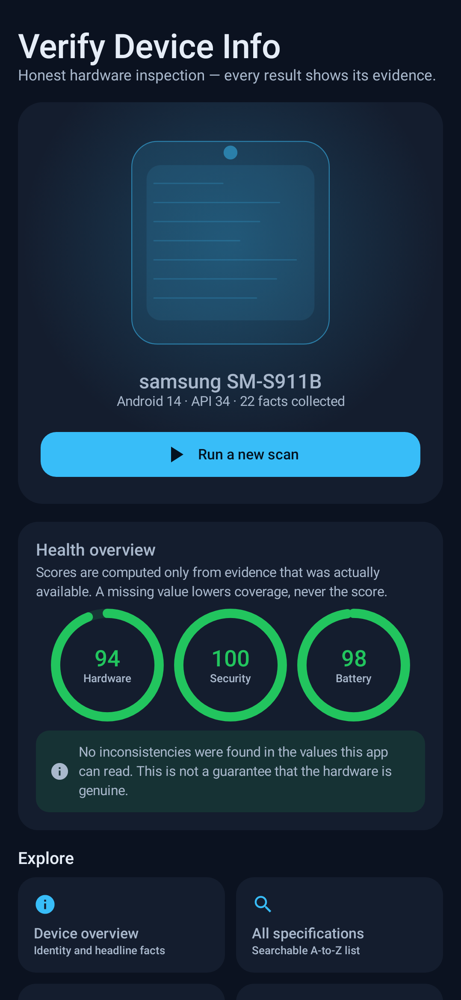
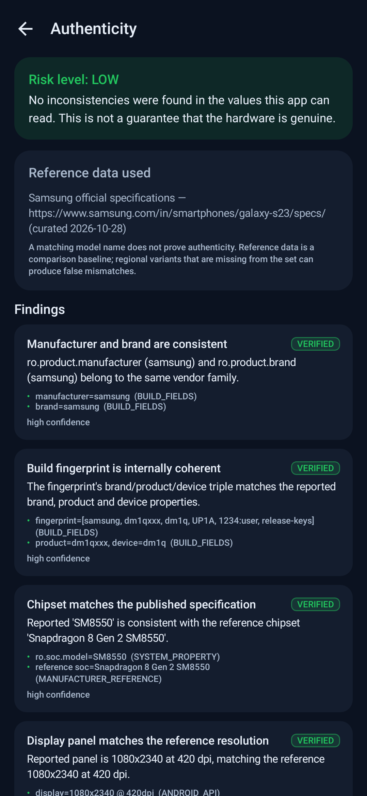
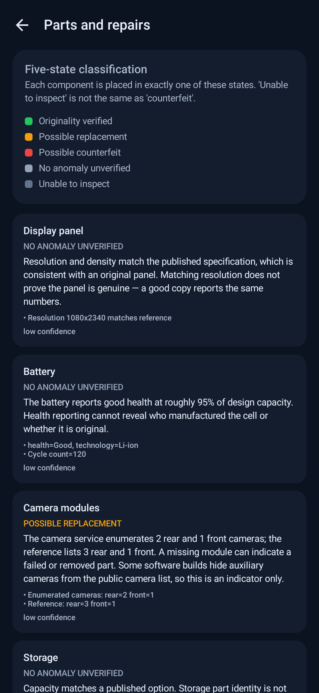
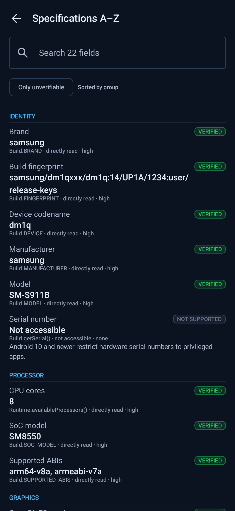
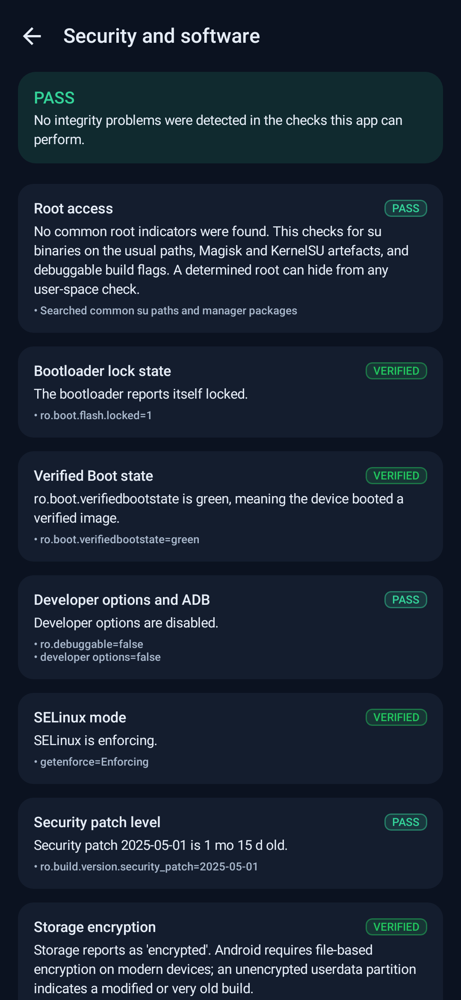
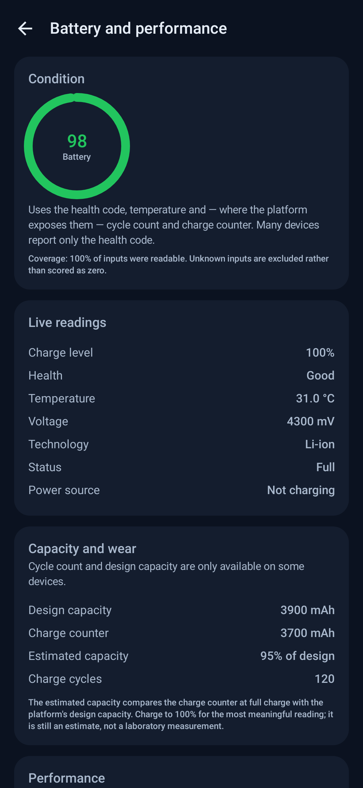
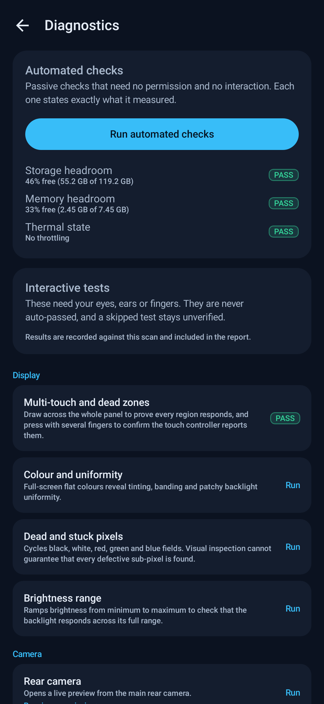

# Verify Device Info

**A device inspection app that tells you what it actually knows — and says so when it doesn't.**

Verify Device Info inspects an Android phone or tablet and reports its identity, hardware, software,
security state and health. It compares what the device claims against curated manufacturer
specifications, flags inconsistencies, and classifies each component as verified, possibly replaced,
possibly counterfeit, unverified, or simply not inspectable.

The app is deliberately conservative. It will tell you that a device *looks* consistent, or that it
found *indicators* worth checking. It will never tell you that a phone is "100% original", because
software cannot establish that.

---

## Screenshots

<p>



</p>
<p>



</p>
<p>

</p>

These are renderings of the shipping composables, produced on the JVM by Robolectric + Roborazzi
(`app/src/test/kotlin/com/verifydeviceinfo/ScreenshotTest.kt`) — not captures from a phone, because
this project was built without access to a device or emulator. The values shown come from the test
fixture, not from a real handset. Regeneration instructions are in
[docs/BUILDING.md](docs/BUILDING.md#regenerating-the-screenshots).

---

## What it does

### Complete device information
Every readable property is collected and shown with its **value, source, confidence level and
verification state** (`directly verified`, `inferred`, or `inaccessible`). That includes identity and
build properties, SoC, GPU, CPU, RAM, storage, display, battery, cameras, sensors, radios, audio
endpoints, biometrics and security configuration. The full list is searchable, A-to-Z.

### Original vs fake hardware analysis
An evidence-based engine compares the device against a bundled reference set of manufacturer
specifications: chipset, display resolution and density, memory and storage options, camera count and
resolution, expected sensors, build fingerprint coherence, signing keys, build type and timestamp,
and emulator markers. Each finding carries its evidence and a confidence level, and each is phrased as
an indicator rather than a verdict.

### Parts and repair analysis
A dedicated module classifies display, battery, cameras, storage, sensors, port/audio/haptics and
motherboard identity into exactly one of five states:

| State | Meaning |
|---|---|
| `ORIGINALITY_VERIFIED` | An official source confirmed the part. Android exposes no such source today, so this is normally empty. |
| `POSSIBLE_REPLACEMENT` | Supporting evidence was detected. |
| `POSSIBLE_COUNTERFEIT` | Multiple independent inconsistencies, or an incompatible component signature. |
| `NO_ANOMALY_UNVERIFIED` | Nothing inconsistent, but originality is unconfirmed. |
| `UNABLE_TO_INSPECT` | The platform would not disclose enough to judge. |

### Device age
Five independent values, never merged into one misleading number: model launch age, firmware build
age, ownership age (from a purchase date you supply), estimated usage age, and time since the last
security patch. The model's launch date is never presented as this handset's manufacturing date, and
no serial number is decoded.

### Deep hardware diagnostics
Interactive tests for multi-touch and dead zones, display colour/uniformity/dead pixels/brightness,
front and rear cameras, flashlight, speaker, earpiece, microphone (with measured levels), vibration,
accelerometer, gyroscope, proximity, ambient light, compass, GNSS, Wi-Fi, Bluetooth, NFC, charging and
battery temperature, thermal state, and biometric availability. Plus passive automated checks that
need no permission and state exactly what they measured.

### System integrity
Root indicators, bootloader lock state, Verified Boot state, SELinux mode, developer/ADB settings,
storage encryption, hardware-backed keystore (probed by generating and deleting a throw-away key),
StrongBox, security-patch age, and installer provenance. Nothing is bypassed, exploited or secretly
accessed.

### Health scores that explain themselves
Seven separate scores — hardware, software and security, component authenticity confidence, battery,
display and sensors, performance, and repair-evidence completeness. Each lists its inputs and weights,
and each reports **coverage**. Unknown data lowers coverage, never the score. Below 30% coverage the
score is withheld rather than guessed.

### Reports
PDF and JSON export, shareable through the system share sheet, with sensitive identifiers redacted by
default. Every export includes the test-by-test results, the evidence behind each finding, and an
explicit list of everything that could not be verified and why.

---

## The rules this app follows

1. **No invented data.** Serial numbers, cycle counts, repair dates and service records are either
   read from the platform or reported as inaccessible.
2. **No fake scans.** The progress bar advances only when a collection stage has actually finished.
   A test that was not run stays `UNVERIFIED`; it is never auto-passed.
3. **No proof claims.** A matching model name does not prove authenticity, and a passing integrity
   check does not prove genuine hardware.
4. **Missing ≠ faulty.** Unavailable data is `UNVERIFIED` or `NOT_SUPPORTED`, never a failure.
5. **Refurbished ≠ counterfeit.** Refurbishment is legitimate and is not treated as fraud.
6. **Every result carries a status**, from this closed set: `VERIFIED`, `PASS`, `WARNING`, `FAILED`,
   `UNVERIFIED`, `NOT_SUPPORTED`, `PERMISSION_REQUIRED`.
7. **Mock data never mixes with real scans.** The development fixture is reachable only in debug
   builds and every surface that shows it labels it as mock.

---

## Install

Download `VerifyDeviceInfo-1.0.0-release.apk` and install it (Android 8.0 / API 26 or newer).

```bash
adb install -r VerifyDeviceInfo-1.0.0-release.apk
```

The release APK is signed with a project key (v2 scheme). It is not published on Google Play.

## Build from source

Requirements: JDK 17, Android SDK with platform 35 and build-tools 35.x.

```bash
git clone <this repository>
cd VerifyDeviceInfo
./gradlew assembleDebug          # debug APK
./gradlew testDebugUnitTest      # unit tests
./gradlew assembleRelease        # signed release (needs keystore.properties, see docs/BUILDING.md)
```

See [docs/BUILDING.md](docs/BUILDING.md) for signing, CI and troubleshooting.

---

## Project structure

```
app/src/main/kotlin/com/verifydeviceinfo/
├── core/            Platform-free model: statuses, confidence, evidence, snapshot, reports
├── domain/          Interfaces + pure-Kotlin analysis engines (portable to iOS)
│   ├── analysis/    Authenticity, parts, age, integrity, scoring
│   └── report/      JSON encoder
├── data/android/    Android implementations: collectors, probes, PDF writer, history
├── ui/              Jetpack Compose UI: dashboard, reports, interactive tests
└── AppContainer.kt  Manual dependency graph
app/src/main/assets/device_reference.json    Curated manufacturer reference set
app/src/test/                                Unit tests for the analysis engines
docs/                                        Architecture, limitations, privacy, build guide
```

Full design notes: [docs/ARCHITECTURE.md](docs/ARCHITECTURE.md).
What the app cannot do, and why: [docs/LIMITATIONS.md](docs/LIMITATIONS.md).

---

## Privacy

The app makes **no network requests**. There is no analytics, no telemetry and no cloud dependency.
Scan history is stored in app-private storage and can be cleared at any time. Reports leave the device
only when you explicitly share them, with identifiers redacted by default.
See [docs/PRIVACY.md](docs/PRIVACY.md).

## Testing

28 unit tests cover the analysis engines: sub-brand recognition, part-number vs marketing-name chipset
matching, fingerprint parsing, risk aggregation, spoofed fingerprints, emulator detection, missing
reference data, the five-state parts classification, age-source separation, and score coverage
behaviour.

```bash
./gradlew testDebugUnitTest
```

## iOS

This repository contains the Android implementation only. The `core` and `domain` layers are written
in platform-free Kotlin, so an iOS app would implement the same interfaces in Swift and reuse the
report schema. **No iOS support is claimed or simulated here** — this build never displays Android
data as if it came from an iPhone.

## Licence

MIT. See [LICENSE](LICENSE).
