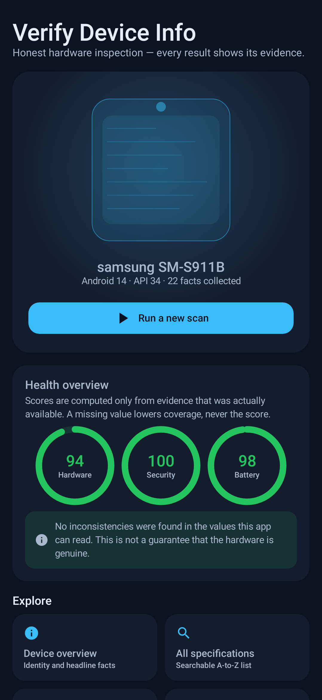
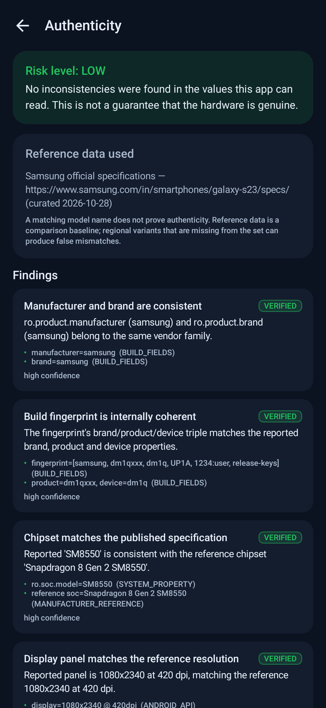
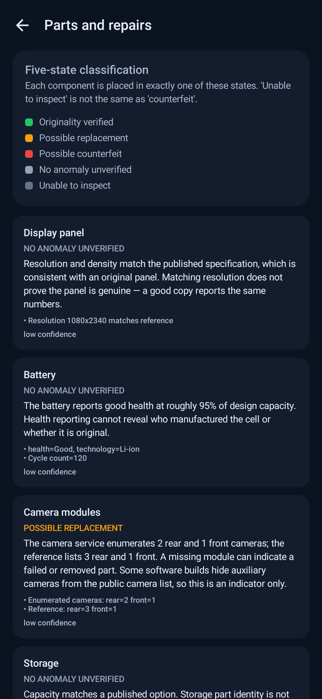
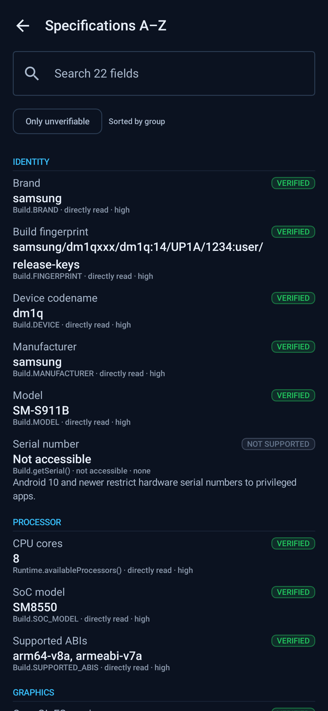
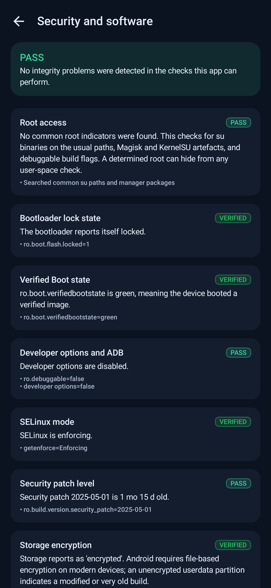
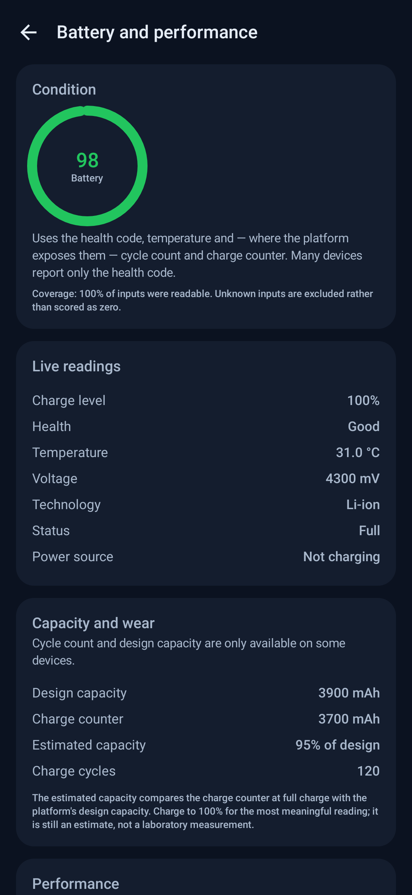
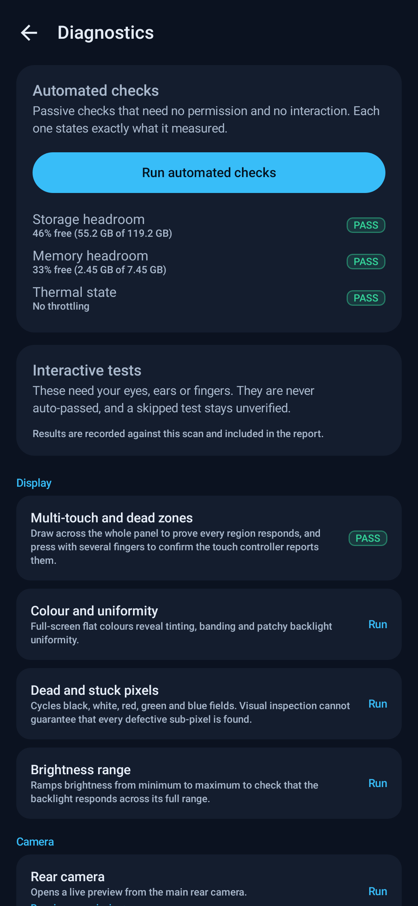

# Verify Device Info

**A device inspection app that tells you what it actually knows — and says so when it doesn't.**

Verify Device Info inspects an Android phone or tablet and reports its identity, hardware, software,
security state and health. It compares what the device claims against curated manufacturer
specifications, flags inconsistencies, and classifies each component as verified, possibly replaced,
possibly counterfeit, unverified, or simply not inspectable.

The app is deliberately conservative. It will tell you that a device *looks* consistent, or that it
found *indicators* worth checking. It will never tell you that a phone is "100% original", because
software cannot establish that.

---

## Screenshots

<p>



</p>
<p>



</p>
<p>

</p>

These are renderings of the shipping composables, produced on the JVM by Robolectric + Roborazzi
(`app/src/test/kotlin/com/verifydeviceinfo/ScreenshotTest.kt`) — not captures from a phone, because
this project was built without access to a device or emulator. The values shown come from the test
fixture, not from a real handset. Regeneration instructions are in
[docs/BUILDING.md](docs/BUILDING.md#regenerating-the-screenshots).

---

## What it does

### Complete device information
Every readable property is collected and shown with its **value, source, confidence level and
verification state** (`directly verified`, `inferred`, or `inaccessible`). That includes identity and
build properties, SoC, GPU, CPU, RAM, storage, display, battery, cameras, sensors, radios, audio
endpoints, biometrics and security configuration. The full list is searchable, A-to-Z.

### Original vs fake hardware analysis
An evidence-based engine compares the device against a bundled reference set of manufacturer
specifications: chipset, display resolution and density, memory and storage options, camera count and
resolution, expected sensors, build fingerprint coherence, signing keys, build type and timestamp,
and emulator markers. Each finding carries its evidence and a confidence level, and each is phrased as
an indicator rather than a verdict.

### Parts and repair analysis
A dedicated module classifies display, battery, cameras, storage, sensors, port/audio/haptics and
motherboard identity into exactly one of five states:

| State | Meaning |
|---|---|
| `ORIGINALITY_VERIFIED` | An official source confirmed the part. Android exposes no such source today, so this is normally empty. |
| `POSSIBLE_REPLACEMENT` | Supporting evidence was detected. |
| `POSSIBLE_COUNTERFEIT` | Multiple independent inconsistencies, or an incompatible component signature. |
| `NO_ANOMALY_UNVERIFIED` | Nothing inconsistent, but originality is unconfirmed. |
| `UNABLE_TO_INSPECT` | The platform would not disclose enough to judge. |

### Device age
Five independent values, never merged into one misleading number: model launch age, firmware build
age, ownership age (from a purchase date you supply), estimated usage age, and time since the last
security patch. The model's launch date is never presented as this handset's manufacturing date, and
no serial number is decoded.

### Deep hardware diagnostics
Interactive tests for multi-touch and dead zones, display colour/uniformity/dead pixels/brightness,
front and rear cameras, flashlight, speaker, earpiece, microphone (with measured levels), vibration,
accelerometer, gyroscope, proximity, ambient light, compass, GNSS, Wi-Fi, Bluetooth, NFC, charging and
battery temperature, thermal state, and biometric availability. Plus passive automated checks that
need no permission and state exactly what they measured.

### System integrity
Root indicators, bootloader lock state, Verified Boot state, SELinux mode, developer/ADB settings,
storage encryption, hardware-backed keystore (probed by generating and deleting a throw-away key),
StrongBox, security-patch age, and installer provenance. Nothing is bypassed, exploited or secretly
accessed.

### Health scores that explain themselves
Seven separate scores — hardware, software and security, component authenticity confidence, battery,
display and sensors, performance, and repair-evidence completeness. Each lists its inputs and weights,
and each reports **coverage**. Unknown data lowers coverage, never the score. Below 30% coverage the
score is withheld rather than guessed.

### Reports
PDF and JSON export, shareable through the system share sheet, with sensitive identifiers redacted by
default. Every export includes the test-by-test results, the evidence behind each finding, and an
explicit list of everything that could not be verified and why.

---

## The rules this app follows

1. **No invented data.** Serial numbers, cycle counts, repair dates and service records are either
   read from the platform or reported as inaccessible.
2. **No fake scans.** The progress bar advances only when a collection stage has actually finished.
   A test that was not run stays `UNVERIFIED`; it is never auto-passed.
3. **No proof claims.** A matching model name does not prove authenticity, and a passing integrity
   check does not prove genuine hardware.
4. **Missing ≠ faulty.** Unavailable data is `UNVERIFIED` or `NOT_SUPPORTED`, never a failure.
5. **Refurbished ≠ counterfeit.** Refurbishment is legitimate and is not treated as fraud.
6. **Every result carries a status**, from this closed set: `VERIFIED`, `PASS`, `WARNING`, `FAILED`,
   `UNVERIFIED`, `NOT_SUPPORTED`, `PERMISSION_REQUIRED`.
7. **Mock data never mixes with real scans.** The development fixture is reachable only in debug
   builds and every surface that shows it labels it as mock.

---

## Install

Download `VerifyDeviceInfo-1.0.0-release.apk` and install it (Android 8.0 / API 26 or newer).

```bash
adb install -r VerifyDeviceInfo-1.0.0-release.apk
```

The release APK is signed with a project key (v2 scheme). It is not published on Google Play.

## Build from source

Requirements: JDK 17, Android SDK with platform 35 and build-tools 35.x.

```bash
git clone <this repository>
cd VerifyDeviceInfo
./gradlew assembleDebug          # debug APK
./gradlew testDebugUnitTest      # unit tests
./gradlew assembleRelease        # signed release (needs keystore.properties, see docs/BUILDING.md)
```

See [docs/BUILDING.md](docs/BUILDING.md) for signing, CI and troubleshooting.

---

## Project structure

```
app/src/main/kotlin/com/verifydeviceinfo/
├── core/            Platform-free model: statuses, confidence, evidence, snapshot, reports
├── domain/          Interfaces + pure-Kotlin analysis engines (portable to iOS)
│   ├── analysis/    Authenticity, parts, age, integrity, scoring
│   └── report/      JSON encoder
├── data/android/    Android implementations: collectors, probes, PDF writer, history
├── ui/              Jetpack Compose UI: dashboard, reports, interactive tests
└── AppContainer.kt  Manual dependency graph
app/src/main/assets/device_reference.json    Curated manufacturer reference set
app/src/test/                                Unit tests for the analysis engines
docs/                                        Architecture, limitations, privacy, build guide
```

Full design notes: [docs/ARCHITECTURE.md](docs/ARCHITECTURE.md).
What the app cannot do, and why: [docs/LIMITATIONS.md](docs/LIMITATIONS.md).

---

## Privacy

The app makes **no network requests**. There is no analytics, no telemetry and no cloud dependency.
Scan history is stored in app-private storage and can be cleared at any time. Reports leave the device
only when you explicitly share them, with identifiers redacted by default.
See [docs/PRIVACY.md](docs/PRIVACY.md).

## Testing

28 unit tests cover the analysis engines: sub-brand recognition, part-number vs marketing-name chipset
matching, fingerprint parsing, risk aggregation, spoofed fingerprints, emulator detection, missing
reference data, the five-state parts classification, age-source separation, and score coverage
behaviour.

```bash
./gradlew testDebugUnitTest
```

## iOS

This repository contains the Android implementation only. The `core` and `domain` layers are written
in platform-free Kotlin, so an iOS app would implement the same interfaces in Swift and reuse the
report schema. **No iOS support is claimed or simulated here** — this build never displays Android
data as if it came from an iPhone.

## Licence

MIT. See [LICENSE](LICENSE).

---

## ⭐ Like this work? Give it a star

If you like this app and our work, please **star this repository** ⭐ and **[follow technicalnihilist-lgtm on GitHub](https://github.com/technicalnihilist-lgtm)**. If our work isn't for you, that's completely fine — the choice is yours. Thank you for stopping by!

<details>
<summary><b>🌍 Same message in 32 languages (A–Z + Indian languages)</b></summary>

- **A — Arabic** (العربية): ⭐ إذا أعجبك هذا التطبيق وعملنا، فيرجى منح المستودع نجمة ومتابعتنا. وإذا لم يعجبك عملنا، فلا مشكلة على الإطلاق — القرار قرارك. شكرًا لزيارتك!
- **B — Bengali** (বাংলা): ⭐ যদি আপনার এই অ্যাপ এবং আমাদের কাজ ভালো লাগে, তবে অনুগ্রহ করে রিপোজিটরিটিকে একটি স্টার দিন এবং আমাদের ফলো করুন। আমাদের কাজ যদি আপনার পছন্দ না হয়, তাতেও কোনো সমস্যা নেই — সিদ্ধান্ত আপনার। আমাদের পেজে আসার জন্য ধন্যবাদ!
- **C — Chinese** (中文): ⭐ 如果你喜欢这个应用和我们的作品，请给仓库点个星标并关注我们。如果我们的作品不适合你，也完全没关系——选择权在你。感谢你的到访！
- **D — Dutch** (Nederlands): ⭐ Vind je deze app en ons werk leuk? Geef de repository dan een ster en volg ons. Vind je ons werk niets, dan is dat helemaal prima — de keuze is aan jou. Bedankt voor je bezoek!
- **E — English** (English): ⭐ If you like this app and our work, please give the repository a star and follow us. If our work isn't for you, that's completely fine — the choice is yours. Thank you for stopping by!
- **F — French** (Français): ⭐ Si cette application et notre travail vous plaisent, mettez une étoile au dépôt et suivez-nous. Si notre travail n'est pas pour vous, aucun souci — c'est votre choix. Merci de votre visite !
- **G — German** (Deutsch): ⭐ Wenn dir diese App und unsere Arbeit gefallen, gib dem Repository einen Stern und folge uns. Wenn unsere Arbeit nichts für dich ist, ist das völlig in Ordnung — die Wahl liegt bei dir. Danke fürs Vorbeischauen!
- **H — Hindi** (हिन्दी): ⭐ अगर आपको यह ऐप और हमारा काम पसंद है, तो कृपया रिपॉजिटरी को स्टार दें और हमें फॉलो करें। अगर हमारा काम आपके लिए नहीं है, तो भी कोई बात नहीं — यह पूरी तरह आपकी मर्ज़ी है। यहाँ आने के लिए आपका धन्यवाद!
- **I — Indonesian** (Bahasa Indonesia): ⭐ Jika kamu suka aplikasi ini dan karya kami, beri bintang pada repositori ini dan ikuti kami. Kalau karya kami bukan untukmu, tidak masalah sama sekali — itu pilihanmu. Terima kasih sudah mampir!
- **J — Japanese** (日本語): ⭐ このアプリと私たちの仕事が気に入ったら、リポジトリにスターを付けてフォローしてください。合わない場合はまったく問題ありません — 選ぶのはあなたです。お越しいただきありがとうございます！
- **K — Korean** (한국어): ⭐ 이 앱과 저희 작업이 마음에 드신다면 저장소에 스타를 눌러 주시고 팔로우해 주세요. 저희 작업이 맞지 않으셔도 전혀 괜찮습니다 — 선택은 여러분의 몫입니다. 방문해 주셔서 감사합니다!
- **L — Lithuanian** (Lietuvių): ⭐ Jei tau patinka ši programa ir mūsų darbas, duok saugyklai žvaigždutę ir sek mus. Jei mūsų darbas ne tau, viskas gerai — pasirinkimas tavo. Ačiū, kad užsukai!
- **M — Malayalam** (മലയാളം): ⭐ നിങ്ങൾക്ക് ഈ ആപ്പും ഞങ്ങളുടെ പ്രവർത്തനവും ഇഷ്ടപ്പെട്ടെങ്കിൽ, ദയവായി റെപ്പോസിറ്ററിക്ക് ഒരു സ്റ്റാർ നൽകുകയും ഞങ്ങളെ ഫോളോ ചെയ്യുകയും ചെയ്യുക. ഞങ്ങളുടെ പ്രവർത്തനം നിങ്ങൾക്ക് അനുയോജ്യമല്ലെങ്കിൽ, അതും തികച്ചും കുഴപ്പമില്ല — തീരുമാനം നിങ്ങളുടേതാണ്. ഇവിടെ വന്നതിന് നന്ദി!
- **N — Nepali** (नेपाली): ⭐ यदि तपाईंलाई यो एप र हाम्रो काम मन पर्‍यो भने, कृपया रिपोजिटरीलाई स्टार दिनुहोस् र हामीलाई फलो गर्नुहोस्। यदि हाम्रो काम तपाईंलाई मन पर्दैन भने, पनि ठीकै छ — यो तपाईंको इच्छा हो। यहाँ आउनुभएकोमा धन्यवाद!
- **O — Odia** (ଓଡ଼ିଆ): ⭐ ଯଦି ଆପଣଙ୍କୁ ଏହି ଆପ୍ ଏବଂ ଆମର କାମ ଭଲ ଲାଗୁଛି, ତେବେ ଦୟାକରି ରିପୋଜିଟୋରୀକୁ ଗୋଟିଏ ଷ୍ଟାର୍ ଦିଅନ୍ତୁ ଏବଂ ଆମକୁ ଫଲୋ କରନ୍ତୁ। ଯଦି ଆମର କାମ ଆପଣଙ୍କ ପାଇଁ ନୁହେଁ, ତେବେ କିଛି ଅସୁବିଧା ନାହିଁ — ପସନ୍ଦ ଆପଣଙ୍କର। ଆମ ପାଖକୁ ଆସିଥିବାରୁ ଧନ୍ୟବାଦ!
- **P — Polish** (Polski): ⭐ Jeśli podoba Ci się ta aplikacja i nasza praca, daj repozytorium gwiazdkę i obserwuj nas. Jeśli nasza praca nie jest dla Ciebie, to zupełnie w porządku — wybór należy do Ciebie. Dziękujemy za odwiedziny!
- **Q — Quechua** (Runa Simi): ⭐ Kay app, ñuqaykup ruwasqanchikpas gustasunki chayqa, repositorioman huk estrella churay, ñuqaykutapas qatipayku. Mana gustasunki chayqa, allinmi — qampa akllayki. Hamusqaykimanta sulpayki!
- **R — Russian** (Русский): ⭐ Если вам нравится это приложение и наша работа, поставьте звёздочку репозиторию и подпишитесь на нас. Если наша работа не для вас — это совершенно нормально, выбор за вами. Спасибо, что заглянули!
- **S — Spanish** (Español): ⭐ Si te gusta esta app y nuestro trabajo, dale una estrella al repositorio y síguenos. Si nuestro trabajo no es para ti, no pasa nada — la decisión es tuya. ¡Gracias por pasarte!
- **T — Tamil** (தமிழ்): ⭐ உங்களுக்கு இந்த ஆப்பும் எங்க வேலையும் பிடிச்சிருந்தா, தயவுசெஞ்சு இந்த ரெபாசிட்டரிக்கு ஒரு ஸ்டார் குடுத்து, எங்களை ஃபாலோ பண்ணுங்க. எங்க வேலை உங்களுக்கு செட் ஆகலைன்னாலும் பரவாயில்லை — அது உங்க விருப்பம். இங்கே வந்ததுக்கு நன்றி!
- **U — Urdu** (اردو): ⭐ اگر آپ کو یہ ایپ اور ہمارا کام پسند آئے تو براہ کرم ریپازٹری کو سٹار دیں اور ہمیں فالو کریں۔ اگر ہمارا کام آپ کے لیے نہیں ہے، تو یہ بالکل ٹھیک ہے — انتخاب آپ کا ہے۔ یہاں تشریف لانے کا شکریہ!
- **V — Vietnamese** (Tiếng Việt): ⭐ Nếu bạn thích ứng dụng này và công việc của chúng tôi, hãy tặng kho lưu trữ một ngôi sao và theo dõi chúng tôi. Nếu công việc của chúng tôi không phù hợp với bạn, điều đó hoàn toàn ổn — lựa chọn là của bạn. Cảm ơn bạn đã ghé qua!
- **W — Welsh** (Cymraeg): ⭐ Os ydych chi'n hoffi'r ap hwn a'n gwaith, rhowch seren i'r storfa a dilynwch ni. Os nad yw ein gwaith ar eich cyfer, mae hynny'n hollol iawn — chi sydd i benderfynu. Diolch am alw heibio!
- **X — Xhosa** (isiXhosa): ⭐ Ukuba uyayithanda le app nomsebenzi wethu, nika irepo inkwenkwezi kwaye usilandele. Ukuba umsebenzi wethu awukufanelanga, akukho ngxaki — lukhetho lwakho. Enkosi ngokutyelela!
- **Y — Yoruba** (Yorùbá): ⭐ Bí app yìí àti iṣẹ́ wa bá wù ọ́, jọ̀wọ́ fún àkójọpọ̀ náà ní ìràwọ̀ kí o sì tẹ̀lé wa. Bí iṣẹ́ wa kò bá yẹ ọ́, kò séwu — ìwọ ni ó yàn. Ẹ ṣé fún wíwá!
- **Z — Zulu** (isiZulu): ⭐ Uma uthanda le app nomsebenzi wethu, nikeza isitoreji inkanyezi bese usilandela. Uma umsebenzi wethu ungakufanele, akunankinga — wukukhetha kwakho. Siyabonga ngokuvakasha!

**More Indian languages**

- **Assamese** (অসমীয়া): ⭐ যদি আপুনি এই এপটো আৰু আমাৰ কাম ভাল পায়, তেন্তে অনুগ্ৰহ কৰি ৰিপজিটৰীটোক এটা ষ্টাৰ দিয়ক আৰু আমাক ফ'ল' কৰক। যদি আমাৰ কাম আপোনাৰ বাবে নহয়, তেন্তে সেয়া একেবাৰে ঠিক আছে — সিদ্ধান্তটো আপোনাৰ। আমাৰ ইয়ালৈ অহাৰ বাবে ধন্যবাদ!
- **Gujarati** (ગુજરાતી): ⭐ જો તમને આ એપ અને અમારું કામ ગમતું હોય, તો પ્લીઝ રિપોઝિટરીને સ્ટાર આપો અને અમને ફોલો કરો. જો અમારું કામ તમને ન ગમતું હોય, તો તે પણ બરાબર છે — પસંદગી તમારી છે. અહીં આવવા બદલ આભાર!
- **Kannada** (ಕನ್ನಡ): ⭐ ನಿಮಗೆ ಈ ಆ್ಯಪ್ ಮತ್ತು ನಮ್ಮ ಕೆಲಸ ಇಷ್ಟವಾದರೆ, ದಯವಿಟ್ಟು ರೆಪೊಸಿಟರಿಗೆ ಸ್ಟಾರ್ ಕೊಡಿ ಮತ್ತು ನಮ್ಮನ್ನು ಫಾಲೋ ಮಾಡಿ. ನಮ್ಮ ಕೆಲಸ ನಿಮಗೆ ಸರಿಹೊಂದದಿದ್ದರೆ, ಅದೂ ಪರವಾಗಿಲ್ಲ — ಆಯ್ಕೆ ನಿಮ್ಮದು. ಭೇಟಿ ನೀಡಿದ್ದಕ್ಕೆ ಧನ್ಯವಾದಗಳು!
- **Marathi** (मराठी): ⭐ जर तुम्हाला हे ॲप आणि आमचं काम आवडलं असेल, तर कृपया रिपॉझिटरीला स्टार द्या आणि आम्हाला फॉलो करा. जर आमचं काम तुम्हाला आवडत नसेल, तर काही हरकत नाही — ती तुमची निवड आहे. इथे आल्याबद्दल धन्यवाद!
- **Punjabi** (ਪੰਜਾਬੀ): ⭐ ਜੇ ਤੁਹਾਨੂੰ ਇਹ ਐਪ ਅਤੇ ਸਾਡਾ ਕੰਮ ਪਸੰਦ ਹੈ, ਤਾਂ ਕਿਰਪਾ ਕਰਕੇ ਰਿਪੋਜ਼ਟਰੀ ਨੂੰ ਸਟਾਰ ਦਿਓ ਅਤੇ ਸਾਨੂੰ ਫਾਲੋ ਕਰੋ। ਜੇ ਸਾਡਾ ਕੰਮ ਤੁਹਾਡੇ ਲਈ ਨਹੀਂ ਹੈ, ਤਾਂ ਕੋਈ ਗੱਲ ਨਹੀਂ — ਚੋਣ ਤੁਹਾਡੀ ਹੈ। ਸਾਡੇ ਪੇਜ 'ਤੇ ਆਉਣ ਲਈ ਧੰਨਵਾਦ!
- **Telugu** (తెలుగు): ⭐ మీకు ఈ యాప్, మా పని నచ్చితే, దయచేసి రిపోజిటరీకి ఒక స్టార్ ఇచ్చి మమ్మల్ని ఫాలో అవ్వండి. ఒకవేళ మా పని మీకు నచ్చకపోతే, పర్వాలేదు — అది మీ ఇష్టం. మమ్మల్ని సందర్శించినందుకు ధన్యవాదాలు!

</details>
